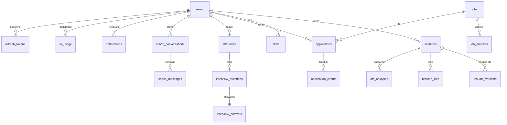

# @careerforge/database

Complete PostgreSQL layer for CareerForge: 29 tables, generated migration, client factory, resume-content schema, and a verification suite that runs on in-memory Postgres.

## Use
    cp .env.example .env        # set DATABASE_URL
    npm install
    npm run migrate             # apply migrations/
    npm run verify              # 16 checks on in-memory Postgres, no server needed

From the API: `import { createDatabase, resumes } from "@careerforge/database"`.
After editing `src/schema/*`: `npm run generate`, read the SQL, commit it, `npm run migrate`, `npm run verify`.

## Tables (29)
| Area | Tables |
|---|---|
| Identity | users, user_profiles, user_settings, oauth_accounts, refresh_tokens, password_reset_tokens, email_verification_tokens |
| Resumes | resumes, resume_versions, resume_files, ats_analyses |
| Skills | skills |
| Jobs | jobs, job_matches, saved_jobs |
| Applications | applications, application_events |
| Interviews | interviews, interview_questions, interview_answers |
| Coach | coach_conversations, coach_messages, learning_plan_steps |
| Progress | readiness_snapshots |
| System | notifications, contact_messages, ai_usage, subscriptions, audit_log |

## Rules the database enforces
- Every user-owned table has `user_id ... ON DELETE CASCADE`: deleting an account is one statement.
- Links that should outlive the other row use SET NULL: applications.resume_id, jobs.created_by_user_id, audit_log.user_id, contact_messages.user_id.
- Emails are unique case-insensitively; skill names are unique per user case-insensitively.
- Scores are 0-100 (ATS, readiness, interview, job match), skill level 1-5, uploads 1 byte to 10 MB.
- job_matches.matched_skills <= required_skills, which powers the "based on X of Y skills" line.
- One match per user+job; one answer per question; unique question order and resume version numbers.
- Secrets (refresh, reset, verification tokens) are stored only as hashes; refresh tokens carry a family_id so token reuse can revoke the whole chain.
- password_hash is nullable so OAuth-only accounts work.
- JSONB only for documents (resume content, ATS breakdown, match reasons); anything filtered or sorted on is a real column.

## Indexes
users lower(email) unique; resumes (user_id, updated_at); ats_analyses (resume_id, created_at); jobs skills GIN and full-text GIN; jobs (source, external_id) unique; applications (user_id, stage, sort_order) for kanban; notifications (user_id, read_at, created_at); refresh/reset/verification (expires_at) for pruning; ai_usage (user_id, created_at) for limits.

## Maintenance
Delete expired refresh, reset and verification tokens daily. Decide retention for coach_messages and ats_analyses.job_description (personal text). Schedule backups and test a restore quarterly. On hosted Postgres use a pooled URL for the API and a direct URL for migrations.

## Not included
Seed data, and payment records beyond `subscriptions` (add invoices when Stripe is wired in).
