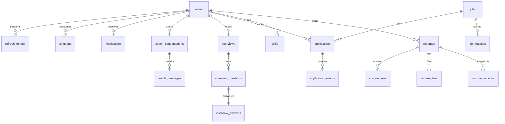

# @careerforge/database

The PostgreSQL layer for CareerForge as its own package: 29 tables, migrations, client factory, shared resume-content validation, seed and a verification suite that runs on in-memory Postgres. It knows nothing about Express or the frontend, and never reads `process.env` (only the CLI and seed scripts do).

```text
database/
├── package.json  tsconfig.json  drizzle.config.ts  .env.example
├── migrations/           generated SQL + meta. Commit it. Never edit an applied file
├── src/
│   ├── index.ts          public API: createDatabase, every table, resumeContent + types
│   ├── client.ts         createDatabase({ connectionString }) -> { db, pool }
│   ├── content.ts        zod schema + types for resumes.content
│   ├── schema/
│   │   ├── _shared.ts    pk(), createdAt(), updatedAt()
│   │   ├── _enums.ts     all enums
│   │   ├── users.ts      users, profiles, settings, oauth, token tables, owner() FK helper
│   │   ├── resumes.ts    resumes, resume_versions, resume_files, ats_analyses
│   │   ├── skills.ts  jobs.ts  applications.ts  interviews.ts  coach.ts  system.ts
│   │   ├── relations.ts  typed joins for db.query.*
│   │   └── index.ts
│   ├── cli/migrate.ts    applies migrations (reads DATABASE_URL)
│   └── seed/             dev data (reads DATABASE_URL, refuses NODE_ENV=production)
└── test/verify.mjs       applies migrations to in-memory Postgres and checks the rules
```

## Use

**Standalone:** `cp .env.example .env`, set `DATABASE_URL`, then `npm install && npm run migrate`. Optional dev data: `npm run seed`. Browse data: `npm run studio`.

**From the API:**

```ts
import { createDatabase, resumes } from "@careerforge/database";
export const { db, pool } = createDatabase({
  connectionString: process.env.DATABASE_URL!,
});
```

Build the package (`npm run build -w database`) before the backend runs, and rebuild after any schema change. Keep one copy of `drizzle-orm` in the workspace so helpers like `eq` and `and` share types with the tables.

## Commands

| Command                       | What it does                                                                                             |
| ----------------------------- | -------------------------------------------------------------------------------------------------------- |
| `npm run generate`            | Diff schema into a new SQL file in `migrations/`. Read it before committing                              |
| `npm run migrate`             | Apply pending migrations (same command in CI and production)                                             |
| `npm run seed`                | Demo data for development. Refuses to run when `NODE_ENV=production`                                     |
| `npm run verify`              | Runs all migrations on in-memory Postgres (PGlite) and checks constraints and cascades. No server needed |
| `npm run typecheck` / `build` | Type-check / compile to `dist/`                                                                          |

## Tables (29)

| Area         | Tables                                                                                                                |
| ------------ | --------------------------------------------------------------------------------------------------------------------- |
| Identity     | users, user_profiles, user_settings, oauth_accounts, refresh_tokens, password_reset_tokens, email_verification_tokens |
| Resumes      | resumes, resume_versions, resume_files, ats_analyses                                                                  |
| Skills       | skills                                                                                                                |
| Jobs         | jobs, job_matches, saved_jobs                                                                                         |
| Applications | applications, application_events                                                                                      |
| Interviews   | interviews, interview_questions, interview_answers                                                                    |
| Coach        | coach_conversations, coach_messages, learning_plan_steps                                                              |
| Progress     | readiness_snapshots                                                                                                   |
| System       | notifications, contact_messages, ai_usage, subscriptions, audit_log                                                   |



## Conventions

- uuid primary keys, `timestamptz` everywhere, snake_case in SQL, camelCase in TypeScript.
- **Every user-owned table has `user_id ... ON DELETE CASCADE`** (`owner()`): deleting an account is one statement.
- Links that should outlive the other row use `SET NULL`: `applications.resume_id`, `jobs.created_by_user_id`, `audit_log.user_id`, `contact_messages.user_id`.
- Emails are unique case-insensitively; skill names are unique per user case-insensitively.
- Check constraints: scores 0-100 (ATS, readiness, interview, job match), skill level 1-5, uploads 1 byte to 10 MB, `matched_skills <= required_skills` (powers "based on X of Y skills").
- One match per user+job, one answer per question, unique question order and resume version numbers.
- Secrets (refresh, reset, verification tokens) are stored only as SHA-256 hashes. Refresh tokens carry a `family_id` so reuse of a stolen token can revoke the whole chain.
- `users.password_hash` is nullable so OAuth-only accounts work.
- Enums only for small stable sets. Add values with a migration; never reorder or remove.
- JSONB only for documents (`resumes.content`, `ats_analyses.breakdown`, `job_matches.reasons`), validated by zod at the API edge. Anything filtered or sorted on is a real column.

## Indexes

| Index                                                   | Serves                         |
| ------------------------------------------------------- | ------------------------------ |
| `users(lower(email))` unique                            | login, duplicate prevention    |
| `resumes(user_id, updated_at)`                          | "my resumes, newest first"     |
| `ats_analyses(resume_id, created_at)`                   | analysis history               |
| `jobs(skills)` GIN + full-text GIN                      | skill-overlap matching, search |
| `jobs(source, external_id)` unique                      | idempotent imports             |
| `applications(user_id, stage, sort_order)`              | kanban columns in order        |
| `notifications(user_id, read_at, created_at)`           | unread badge and list          |
| `ai_usage(user_id, created_at)`                         | usage limits and cost reports  |
| `refresh_tokens`, reset and verification `(expires_at)` | pruning expired tokens         |

## Changing the schema

1. Edit `src/schema/*`. 2. `npm run generate`. 3. Read the SQL and commit it with the schema change. 4. `npm run migrate`, `npm run verify`, `npm run build`.

Rules: one concern per migration; never edit or delete an applied migration (write a new one); for risky changes use expand, then contract (add the new column, write both, backfill, switch reads, drop the old column in a later release). A new table gets its own schema file using `pk()`, `createdAt()` and `owner()`, an export from `schema/index.ts`, relations if you will join it, and a rule in `test/verify.mjs`.

## Maintenance to schedule

- Delete expired `refresh_tokens`, `password_reset_tokens` and `email_verification_tokens` daily.
- Decide retention for `coach_messages` and `ats_analyses.job_description` (personal text).
- Automated backups and a quarterly restore test.
- Hosted Postgres such as Neon: pooled URL for the API, direct URL for migrations.

## Not included yet

Invoice and payment records beyond `subscriptions`; add them when Stripe is wired in.
